# Adrián Portillo

**I build software that moves.** 
Front-end architecture · SaaS products · Data & AI · 3D · music

 

### `01` Origin

Computer Engineer from the **University of Granada** and **MSc in Data Science** at **UNED**. I learned to code by making things move: drones, robots, games and sound.
Selected for **Programa Desafía Switzerland** (ICEX / Red.es), focused on Swiss deep tech and entrepreneurship.

### `02` Craft

<table>
  <tr>
    <td width="50%" valign="top">
      <code>SENIOR FRONT-END ARCHITECT</code>
      <h4><a href="https://go-planner.com">Go!Planner</a></h4>
      Modular SaaS TMS + ERP for road and port logistics: route planning, real-time fleet tracking, documents and invoicing. Shared design foundations across web and the driver app.  
      <code>Angular</code> <code>React</code> <code>Flutter</code> <code>TypeScript</code>
    </td>
    <td width="50%" valign="top">
      <code>LEAD FRONT-END DEVELOPER</code>
      <h4><a href="https://satinel-system.com">Satinel System</a></h4>
      Leading the modernisation of core web applications and turning data into clear interfaces, in an ISO 27001 / ISO 9001 environment.  
      <code>Angular</code> <code>Next.js</code> <code>TypeScript</code>
    </td>
  </tr>
</table>

### `03` Lab

My own products, built and launched end to end.

<table>
  <tr>
    <td width="50%" valign="top">
      
      <h4><a href="https://slawly.com">Slawly</a></h4>
      <i>Your firm up to date, your clients in the loop.</i> 
      Verified lawyers for clients, and practice software for firms: deadlines that know Spanish holidays, encrypted documents, client portal and payments.
    </td>
    <td width="50%" valign="top">
      
      <h4><a href="https://workrawler.com">Workrawler</a></h4>
      <i>The employers who need you are already posting.</i> 
      Crawls job boards, search, maps and company sites to find who's hiring, and scores every lead with quotes from the source.
    </td>
  </tr>
  <tr>
    <td width="50%" valign="top">
      
      <h4><a href="https://pan-flow.com">pan-flow</a></h4>
      <i>From order to oven, and oven to delivery.</i> 
      Operations for wholesale bakeries: recurring orders, production lists, delivery routes, price agreements, invoicing and margins.
    </td>
    <td width="50%" valign="top">
      
      <h4><a href="https://qrasca.com">QRasca</a></h4>
      <i>Prizes you scratch. Cards you stamp.</i> 
      Digital scratch cards and stamp cards on a QR code for local businesses. No app, no sign-up, anti-fraud built in.
    </td>
  </tr>
</table>

### `04` Skills

Architecture first · performance is a feature · data where it adds value · secure by default · ship it.

### `05` Athetosis

When I close the editor, I switch on the machines. **Athetosis** is my electronic music project, somewhere between hip hop and the experimental.

### `06` Arcade

**[adrianportillo.vercel.app](https://adrianportillo.vercel.app)**: my portfolio as a playable thing ([source](https://github.com/adri95cadiz/portfolio)). A scroll-driven Three.js story, a 16-step drum machine fully synthesized in Web Audio, a rhythm game at 174 BPM, scenery you can shoot to pieces, and 11 achievements to find.

### `07` Let's talk

Got something that needs to move? A custom platform, an MVP, an internal tool or a website people remember.

